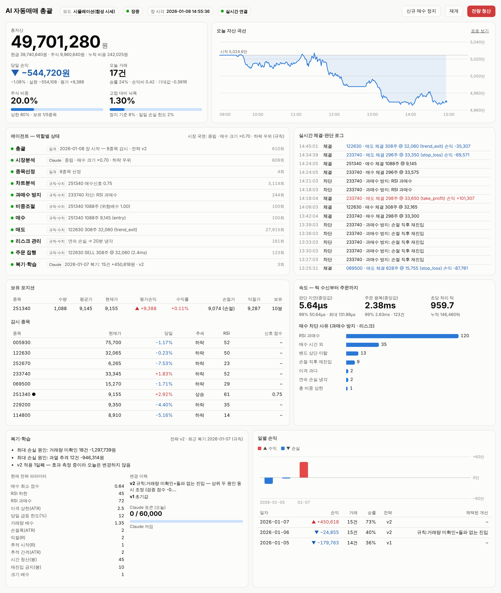

# AI 자동매매 시스템

여러 역할의 에이전트가 시세를 받아 스스로 사고팔고, 장이 끝나면 손실 원인을 복기해 다음 날 전략을 고치는 프로그램입니다.
매매 전 과정을 실시간으로 보는 **총괄 대시보드**가 함께 뜹니다.



## 먼저 알아야 할 것

1. **삼성증권은 직접 연결할 수 없습니다.** 삼성증권은 개인 고객용 매매 Open API를 공개하지 않습니다(조사 시점 2026-11, 공개 자료 기준 — 정확한 최신 여부는 삼성증권에 문의). 그래서 증권사 연동부를 교체 가능한 부품으로 만들었고, 개인에게 API를 공식 제공하는 **한국투자증권(KIS)** 연동을 넣었습니다. 삼성증권이 API를 열면 `aitrader/brokers/base.py`의 `Broker`만 구현하면 됩니다. HTS/MTS 화면을 매크로로 조작하는 방식은 느리고 깨지기 쉬우며 약관 문제가 있어 만들지 않았습니다.
2. **수익을 보장하지 않습니다.** 이 저장소의 손익 수치는 전부 추세가 섞인 *합성 시세*에서 나온 것으로, 시스템이 끝까지 정상 동작하는지 보여줄 뿐 실전 수익성의 근거가 아닙니다.
3. **실제 증권사 서버로는 아직 한 번도 돌려 보지 않았습니다.** KIS 연동은 공식 예제의 형식을 흉내 낸 가짜 서버로만 검증했습니다. 반드시 `모의투자 → 소액 실전` 순서로 확인하세요.

## 빠른 시작

```bash
cd ai-trader
python3 -m venv .venv && .venv/bin/pip install -e ".[dev]"
```

```bash
.venv/bin/python -m aitrader run          # 시뮬레이션 + 대시보드 http://127.0.0.1:8787
```

```bash
.venv/bin/python -m pytest                # 테스트 35개
```

| 명령 | 하는 일 |
|---|---|
| `run --mode sim [--speed 120] [--days N]` | 합성 시세로 전체 시스템 실행(돈 안 듦) |
| `run --mode kis-mock` | 한국투자증권 **모의투자** 계좌로 실행 |
| `run --mode kis-live` | 실전. `AITRADER_LIVE_CONFIRM` 환경변수가 있어야 시작 |
| `backtest --days 20` | 합성 시세 백테스트 |
| `bench` | 틱→주문결정 지연 측정 |

## 에이전트 역할

| 역할 | 무엇을 하나 | 방식 | 주기 |
|---|---|---|---|
| **총괄** | 하루 일과(장전 준비→장중→장후 복기) 진행, 시세 끊김·계좌 불일치 감시 | 일과 | 상시 |
| **종목선정** *(추가)* | 후보 중 거래대금·변동성이 적당한 종목만 감시 | 규칙 | 장전 1회 |
| **시장분석** | 시장 폭·등락·변동성(+뉴스 제목)으로 매수 크기 배수와 회피 종목 결정 | 규칙(매분) + Claude(상황이 바뀔 때만) | 느림 |
| **차트분석** | 추세·VWAP·돌파·RSI·거래량을 점수화해 매수 신호 생성 | 규칙·수치 | 봉마다 |
| **과매수 방지** | RSI 과열, 이격 과다, 밴드 상단 이탈, 당일 급등, 손절 직후 재진입을 차단 | 규칙·수치 | 신호마다 |
| **비중조절** | "손절되면 자산의 0.5%를 잃는" 수량 계산, 종목·총 비중 상한 적용 | 규칙·수치 | 신호마다 |
| **매수** | 시장성 지정가(매도1호가+1틱) 주문 생성 | 규칙·수치 | 신호마다 |
| **매도** | 손절·익절·추적손절(틱마다), 추세이탈·시간청산(봉마다), 장마감 청산 | 규칙·수치 | **틱마다** |
| **리스크 관리** *(추가)* | 일일 손실 한도, 최대 낙폭 정지, 주문 폭주·연속 손실 냉각 | 규칙·수치 | 상시 |
| **주문 집행** *(추가)* | 증권사로 주문 전송, 체결 추적, 미체결 취소, 통보 누락 대비 재확인 | 비동기 | 주문마다 |
| **복기·학습** *(추가)* | 손실 원인 분석 → 개선안 검증 → 전략 갱신/롤백 | 규칙 + Claude | 장후 1회 |

**시장분석·차트분석을 Claude가 직접 하지 않는 이유.** 차트분석은 숫자 계산이라 규칙 엔진이 수십만 배 빠르고(마이크로초 대 초) 결과도 매번 같습니다. 그래서 Claude는 속도가 필요 없는 두 곳 — 시장 국면 판단과 장후 복기 — 에만 씁니다. Claude가 꺼져도(키 없음·장애·예산 소진) 매매는 규칙만으로 계속됩니다.

## 속도

- 틱 수신 → 매도검사 → 봉 갱신 → 차트분석 → 과매수 방지 → 비중조절 → 매수 → 리스크 → 주문까지가 **한 스레드 안의 함수 호출**입니다. 에이전트 사이에 큐·네트워크·LLM이 없습니다.
- 지표는 증분 계산(봉 1개당 O(1)), 일지 기록은 별도 스레드, 이벤트 루프는 uvloop, JSON은 orjson.
- 이 환경에서 잰 값: 틱→주문결정 **중앙값 0.5~4µs, 99% 50µs 미만**, 초당 약 90만 틱 처리(`bench`).
- 실전에서 체감 속도를 정하는 것은 프로그램이 아니라 **증권사 서버까지의 네트워크 왕복(수십 ms)** 입니다. 서울 리전 서버에서 돌리는 것이 가장 효과가 큽니다. 개인용 API로 초단타(HFT) 기관과 속도 경쟁을 하는 것은 불가능하다는 점은 알고 계셔야 합니다.

## 토큰 절약

| 장치 | 효과 |
|---|---|
| 핫패스에 LLM 없음 | 틱·주문마다 0토큰 |
| 상태 서명 게이팅 | 시장 지표가 구간 단위로 바뀌었을 때만 Claude 호출(최소 30분 간격, 하루 최대 10회) |
| 압축 입력 | 원시 시세 대신 수치 요약(시장분석 입력 1,500자 미만, 복기 6,000자 미만) |
| JSON 스키마 출력 + 낮은 effort | 설명문 없이 필요한 필드만 |
| 같은 입력 재사용 | 입력 해시가 같으면 호출 생략 |
| 일일 토큰 예산 | 기본 6만 토큰 — 넘으면 규칙 기반으로 자동 전환 |
| 시뮬레이션 기본 차단 | 배속 시뮬레이션이 실제 API 비용을 태우지 않음(`--llm`으로 켬) |

기본 모델은 `claude-opus-5-5`이고, 거절 응답 시 서버 측 대체 모델 자동 전환(`fallbacks`)을 켜 두었습니다. 장중 시장분석 모델을 `claude-haiku-5-5`로 바꾸면 토큰 단가가 약 1/40이 됩니다(`config.toml`의 `[llm] model_market`). 예상 사용량은 하루 수 회 호출 × 호출당 1천 토큰 안팎이지만, 실제 API로 호출해 본 적은 없어 추정치입니다 — 대시보드의 토큰 미터로 확인하세요.

## 스스로 개선되는 방식

장 마감 후 복기 에이전트가 매일 다음을 합니다.

1. 손실 거래마다 원인 태그를 붙임: 과열 추격, 빠른 손절, 수익 반납, 약한 추세 진입, 거래량 미확인, 돌파 없는 진입, 비용 손실 등.
2. 원인별 손실액을 집계해 가장 비싼 실수를 찾음.
3. 개선 후보 생성 — 규칙 기반 후보 + Claude가 통계를 보고 낸 후보.
4. 후보를 **최근 실제 기록 봉으로 재생**해 검증. 기간을 둘로 나눠 양쪽 모두에서 나빠지지 않고 전체가 5% 이상 좋아질 때만 채택.
5. 채택 후 3일은 효과를 지켜봄. 새 버전의 실전 기대값이 이전보다 나쁘면 **자동 롤백**. 3일 연속 손실이면 거래 크기를 줄임.

학습이 바꿀 수 있는 것은 진입 기준·손절폭 같은 전략 파라미터뿐이고(범위·1회 변경폭 제한), **위험 한도는 못 건드립니다.**

합성 시세 30일 × 시드 4개에서 학습을 켠 쪽이 4번 모두 손익이 더 좋았습니다(+8~+47%). 다만 합성 시세는 성질이 변하지 않아 학습에 유리한 환경이고 표본도 4개뿐이라, "검증·채택·롤백 장치가 동작한다"는 것 이상을 뜻하지 않습니다.

## 사람이 없어도 돌아가게

- 일과 자동 진행: 08:40 종목선정·지표 예열 → 09:05~14:50 매수 → 15:15 전량 청산 → 15:40 복기 → 다음 거래일 대기(휴장일은 KIS 조회).
- 장애 대응: 웹소켓 끊김 시 자동 재연결, 시세 15초 지연 시 신규 매수 보류, 토큰 자동 갱신, 체결통보 누락 시 조회로 보완, 1분마다 계좌 대사.
- 재시작 안전: 보유 포지션·정지 상태를 디스크에 저장. 낙폭 정지는 재시작해도 풀리지 않음.
- 자동 재기동: `deploy/aitrader.service`(systemd) 또는 `deploy/docker-compose.yml`. *(두 배포 파일은 이 환경에서 실행해 보지 못했습니다.)*
- 봇은 **자기가 산 종목만** 관리합니다. 같은 계좌의 다른 보유 주식은 건드리지 않지만, 전용 계좌를 쓰는 것을 권합니다.

### 기본 위험 한도 (`config.toml`의 `[risk]`)

| 한도 | 기본값 | 도달 시 |
|---|---|---|
| 거래당 위험 | 자산의 0.5% | — |
| 종목당 / 총 비중 | 20% / 80% | 매수 수량 축소 |
| 일일 손실 | −2% | 전량 청산, 그날 매매 중단 |
| 최대 낙폭 | −8% | 전량 청산 후 **완전 정지** — 대시보드에서 [재개]를 눌러야 풀림 |
| 연속 손실 4회 | — | 20분 냉각 |

## 한국투자증권 연결

1. 한국투자증권 계좌 개설 → [KIS Developers](https://apiportal.koreainvestment.com)에서 **모의투자** 앱키 발급.
2. `.env.example`을 `.env`로 복사해 `KIS_APP_KEY`, `KIS_APP_SECRET`, `KIS_ACCOUNT`, `KIS_HTS_ID` 입력.
3. `python -m aitrader run --mode kis-mock` 으로 최소 2주 관찰.
4. 실전 전환: 실전 앱키로 교체, `config.toml`의 `capital`(봇이 쓸 최대 금액)을 소액으로, `AITRADER_LIVE_CONFIRM` 설정.

레버리지·인버스2X ETF는 증권사 사전교육 이수 등 거래 요건이 있을 수 있습니다. 요건이 안 되면 `universe`에서 빼세요.

## 왜 ETF 위주인가

첫 실행에서 1분봉 전략이 구조적으로 손실 나는 것을 확인했습니다. 원인은 비용이었습니다: 일반 주식은 매도 세금(약 0.2%)과 큰 호가단위 때문에 왕복 비용이 0.4~0.6%인데, 1분봉 손절폭은 0.3% 안팎이라 이겨도 남는 게 없습니다. 그래서 (a) 기본 종목을 거래세가 없고 호가단위가 5원인 ETF로, (b) 봉을 3분으로, (c) **손절폭은 왕복 비용의 4배 이상**이라는 규칙을 넣었습니다.

## GitHub에서 찾아 적용한 것

| 저장소 | 어떻게 썼나 |
|---|---|
| [koreainvestment/open-trading-api](https://github.com/koreainvestment/open-trading-api) | 공식 예제에서 주문·조회·웹소켓 스펙 확인(주문 TR ID가 `TTTC0012U/0011U`로 바뀐 것 반영) |
| [aio-libs/aiohttp](https://github.com/aio-libs/aiohttp) | 증권사 REST/웹소켓 + 대시보드 서버 |
| [MagicStack/uvloop](https://github.com/MagicStack/uvloop), [ijl/orjson](https://github.com/ijl/orjson) | 이벤트 루프·JSON 가속 |
| [anthropics/anthropic-sdk-python](https://github.com/anthropics/anthropic-sdk-python) | Claude 호출 |
| [TauricResearch/TradingAgents](https://github.com/TauricResearch/TradingAgents) | 역할 분담 구조만 참고. 매 판단마다 LLM끼리 토론하는 방식이라 속도·토큰 요구와 맞지 않아 코드는 쓰지 않음 |

## 폴더

```
aitrader/
  engine.py        빠른 경로 전체(틱→주문)
  agents/          chart · guards(과매수 방지·리스크) · trade(비중·매수·매도) · market(시장분석·종목선정) · learner(복기)
  executor.py      주문 집행        supervisor.py  총괄
  llm.py           Claude 호출·예산  backtest.py    검증용 재생
  brokers/         base(인터페이스) · sim(합성 시세) · kis(한국투자증권)
  dashboard/       서버 + 화면       journal.py     매매 일지(SQLite)
data/<mode>/       journal.db · params.json(학습된 전략) · state.json
```
